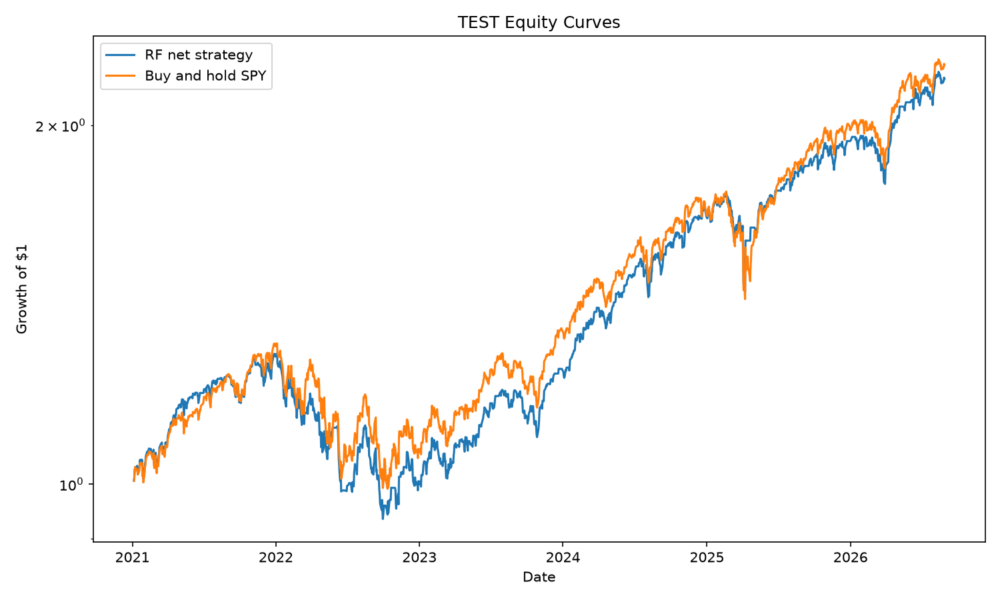
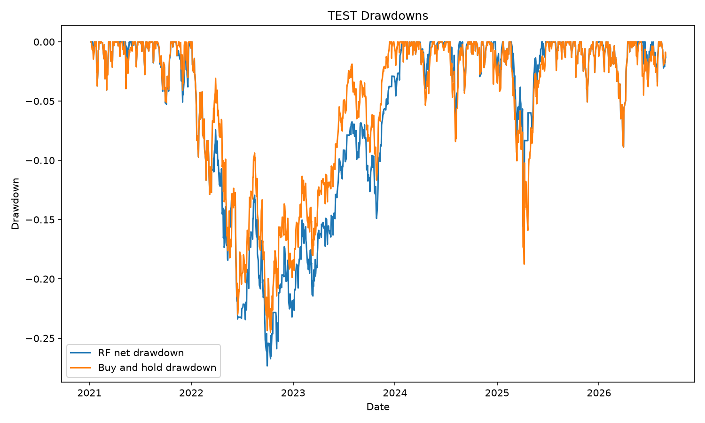
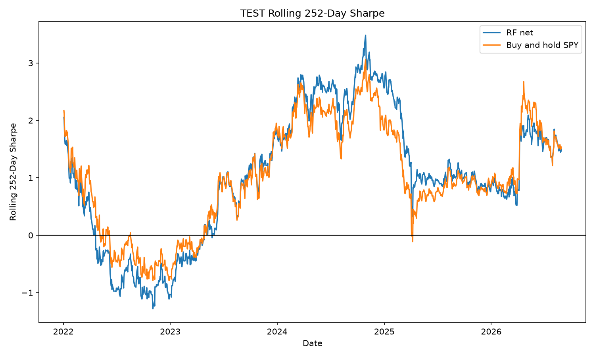
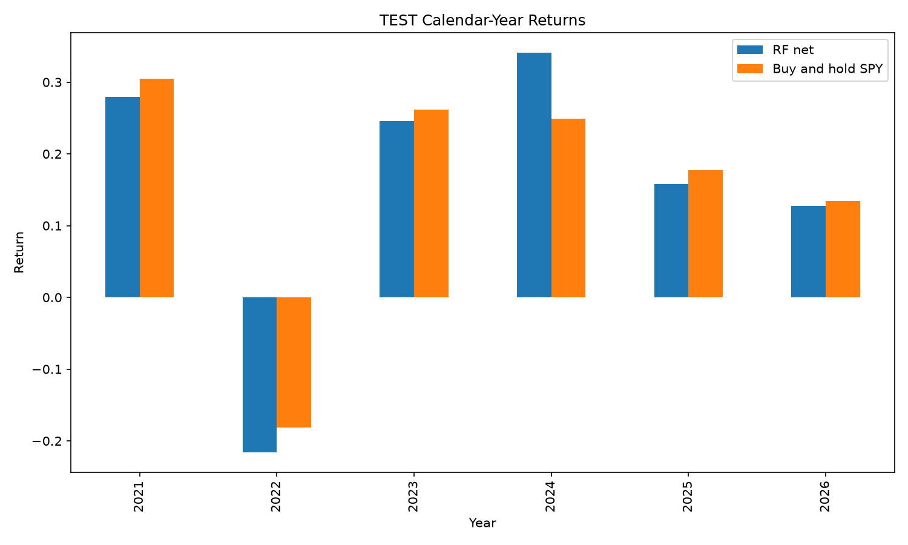

# SPY 5-Day Direction Classifier

## 1. Summary

This project tests whether nine price and volume features can predict whether SPY will close higher five trading days later, and whether that ranking signal survives in a long/cash strategy after transaction costs.

On the held-out TEST period, the Random Forest achieved ROC-AUC of **0.537751** and accuracy of **0.590141**, below the **0.600704** always-up base rate. The RF net strategy produced **14.9162% CAGR**, **15.53% annualised volatility**, **0.9731 Sharpe**, **-27.33% maximum drawdown**, and **86.40% exposure**.

Buy and hold produced **15.4597% CAGR**, **0.9431 Sharpe**, and **-24.50% maximum drawdown**. The fixed 50/200-day moving-average rule produced **13.3597% CAGR**, **0.9993 Sharpe**, and **-18.76% maximum drawdown**.

The model shows weak out-of-sample ranking ability, but it does not demonstrate a clear or robust economic advantage over simple benchmarks after transaction costs.

## 2. Research Question

Can a small set of price and volume features predict whether SPY closes higher five trading days later, and does any predictive ability survive into a long/flat strategy that beats simple benchmarks?

## 3. Data

The dataset contains daily adjusted Open, High, Low, Close, and Volume data for SPY from **2005-01-03** through **2026-09-14**, downloaded with `yfinance` using `auto_adjust=True`. Adjustment matters because it makes historical prices consistent across distributions and corporate actions.

The data checks covered shape and date range, missing values, duplicate dates, daily-return descriptive statistics, and the ten largest absolute daily returns. There were no missing values or duplicate dates, and the largest moves were plausible market events. The cleaned data is cached at `data/raw/SPY.parquet` and reused unless a refresh is requested.

## 4. Features and Target

| Feature | Definition |
|---|---|
| `ret_1` | One-day log return |
| `ret_5` | Rolling sum of log returns over 5 trading days |
| `ret_20` | Rolling sum of log returns over 20 trading days |
| `ma_dist_20` | Close divided by its 20-day rolling mean, minus 1 |
| `ma_dist_50` | Close divided by its 50-day rolling mean, minus 1 |
| `vol_10` | 10-day standard deviation of log returns, annualised by `sqrt(252)` |
| `vol_20` | 20-day standard deviation of log returns, annualised by `sqrt(252)` |
| `volu_rel` | Volume divided by its 20-day rolling mean |
| `hl_range` | Daily high-low range divided by Close |

The target is 1 when SPY closes higher five trading days after date `t`, and 0 otherwise. Every feature dated `t` uses only information known by the close of `t`; raw Close is not a model feature. In the genuine modelling pipeline, `shift(-5)` appears only in the label. Because adjacent targets cover overlapping five-day periods, the effective number of independent observations is lower than the row count.

## 5. Train / Validation / Test Split

| Block | Period | Purpose |
|---|---|---|
| TRAIN | 2005-2016 | Fit the model once |
| VALIDATION | 2017-2020 | Evaluate classification and select the exposure target |
| TEST | 2021 onward | Final out-of-sample evaluation after all decisions were frozen |

The last five observations of each chronological block are purged. Without this purge, a label near a block boundary could use a future Close from the next block. The model was fitted only on TRAIN, VALIDATION was used for threshold selection, and TEST was opened once after the methodology and numeric cutoff were frozen. The model was not refitted on TRAIN plus VALIDATION.

## 6. Baselines

1. **Always-up classifier:** predicts class 1 for every observation. It asks whether the classifier improves on the unconditional tendency of SPY to rise over five trading days.
2. **Buy-and-hold SPY:** remains fully invested. It is the main benchmark for investment returns.
3. **50/200-day MA rule:** is long when the 50-day moving average is above the 200-day moving average and otherwise holds cash. It asks whether the ML strategy improves on a simple long/cash trend rule under the same lag and cost convention.

## 7. Random Forest Model

The sole model is `RandomForestClassifier` with the following fixed settings:

```python
n_estimators=500
max_depth=4
min_samples_leaf=50
max_features="sqrt"
random_state=0
n_jobs=-1
class_weight=None
```

Shallow trees and large leaves intentionally restrain model complexity in a noisy, modest-sized time series. Version 1 used no grid search, no hyperparameter tuning, and no alternative model selection.

## 8. Validation and Threshold Selection

VALIDATION had a positive-class base rate of **0.647705**, accuracy of **0.595808** at the temporary 0.50 classification cutoff, and ROC-AUC of **0.493915**. The aggregate AUC did not show useful ranking ability.

The exposure candidates and selection rule were registered before their results were calculated: choose the highest validation-period net Sharpe, unless two candidates are within 0.05 Sharpe, in which case choose the higher exposure.

| Target exposure | Score cutoff | Actual exposure | Net Sharpe | Net CAGR | MaxDD | Turnover/year |
|---:|---:|---:|---:|---:|---:|---:|
| 70% | 0.540488139218 | 69.9301% | 1.033327 | 17.6433% | -19.1740% | 54.1259 |
| 50% | 0.567047709511 | 50.0500% | 0.460061 | 4.9833% | -23.8130% | 53.6224 |
| 30% | 0.596573634366 | 30.0699% | 0.112691 | 0.6273% | -20.7377% | 43.8042 |

The selected target exposure was **70%**, with the exact numeric cutoff frozen at **0.540488139218**. Each cutoff was derived only from the VALIDATION model-score distribution. The frozen cutoff was then applied unchanged to TEST; no TEST quantile was calculated. The `predict_proba` outputs are model scores, not calibrated probabilities.

## 9. Out-of-Sample TEST Classification Results

TEST contains **1,420 observations** from **2021-01-04** through **2026-08-28**.

| Metric | TEST result |
|---|---:|
| Positive-class base rate | 0.600704 |
| Accuracy at temporary 0.50 cutoff | 0.590141 |
| ROC-AUC | 0.537751 |

| Year | ROC-AUC |
|---:|---:|
| 2021 | 0.546771 |
| 2022 | 0.536102 |
| 2023 | 0.555783 |
| 2024 | 0.531101 |
| 2025 | 0.478540 |
| 2026 | 0.563410 |

Accuracy did not beat the always-up classifier. Aggregate AUC indicates weak positive ranking ability, but the yearly values are not perfectly stable and fell below 0.50 in 2025. The result is evidence of a small ranking signal in this sample, not proof of alpha.

## 10. Backtest Methodology

The five-day classifier produces a fresh score each day, and the strategy is rebalanced daily using the latest score. It does not hold each prediction as a separate five-day trade. The signal is long/cash only.

A signal decided at the close of day `t` affects the position from day `t+1`, implemented as `pos = sig.shift(1)`. Gross return is position times the daily SPY return. Net return subtracts turnover costs. With `cost_bps=2.0`, each unit of turnover costs 2 basis points: entry from 0 to 1 costs 2 bp and exit from 1 to 0 costs another 2 bp, for a 4 bp complete cycle. Sharpe ratios use 252 trading days and a zero risk-free rate.

## 11. Final Results

All strategies use the same aligned TEST return dates, **2021-01-05** through **2026-08-28**.

| Metric | RF net | RF gross | MA rule | Buy and hold |
|---|---:|---:|---:|---:|
| Accuracy vs TEST base rate | 0.590141 vs 0.600704 | - | - | - |
| ROC-AUC | 0.537751 | - | - | - |
| Exposure | 86.3989% | 86.3989% | 81.2544% | 100.0000% |
| Total return | 118.7782% | 125.4860% | 102.6065% | 124.6691% |
| CAGR | 14.9162% | 15.5342% | 13.3597% | 15.4597% |
| Annualised volatility | 15.5260% | 15.5240% | 13.4534% | 16.7263% |
| Sharpe | 0.9731 | 1.0077 | 0.9993 | 0.9431 |
| Maximum drawdown | -27.3337% | -27.0714% | -18.7552% | -24.4964% |
| Turnover/year | 26.8161 | 26.8161 | 0.8879 | 0.0000 |

RF net CAGR was below buy and hold, while its Sharpe was slightly higher. The MA rule had lower CAGR than RF net but a slightly higher Sharpe and a smaller drawdown. Transaction costs reduced RF CAGR from 15.5342% gross to 14.9162% net, a drag of approximately **0.618 percentage points**, and reduced Sharpe from 1.0077 to 0.9731. The RF strategy was invested on about **86.4%** of TEST days.

| Calendar period | RF net | Buy and hold |
|---|---:|---:|
| 2021 | 27.9426% | 30.5055% |
| 2022 | -21.5823% | -18.1754% |
| 2023 | 24.5371% | 26.1758% |
| 2024 | 34.0646% | 24.8865% |
| 2025 | 15.8011% | 17.7191% |
| 2026 YTD | 12.7844% | 13.4207% |

RF net beat buy and hold only in 2024 among these six calendar periods.









## 12. Pipeline Validation

### Synthetic Random-Data Test

The clean synthetic random walk was intentionally constructed without a predictive relationship between historical features and future direction. Its TEST ROC-AUC was **0.503021**, close to the expected 0.50. This supports the absence of obvious accidental leakage in the clean pipeline.

### Leakage Canary

An isolated, intentionally invalid `CHEAT` feature directly containing the future five-day return produced **1.000000 TEST ROC-AUC** and **1.000000 accuracy**. Its illustrative leaked backtest produced **59.0531% gross CAGR**, **57.5078% net CAGR**, **3.9045 gross Sharpe**, **3.8175 net Sharpe**, and **-3.8842% net maximum drawdown**.

`CHEAT` was never included in the genuine SPY feature matrix or model. The canary demonstrates how look-ahead leakage can create absurdly strong classification and trading results.

## 13. Limitations

- The experiment covers a single asset.
- It uses one chronological train/validation/test split.
- Overlapping five-day labels reduce the effective sample size.
- The backtest has transaction costs but no slippage model.
- Sharpe ratios assume a zero risk-free rate.
- Random Forest scores are not calibrated probabilities.
- RF and MA exposure differs from buy-and-hold exposure.
- The strategy rebalances a five-day forecast daily rather than modelling overlapping five-day positions directly.

## 14. Next Steps

These extensions were deferred and were not part of Version 1:

- **v2:** expanding-window walk-forward evaluation with embargo, transaction-cost sensitivity, volatility regime conditioning, and rolling feature importance.
- **v3:** a permutation null distribution, multiple random seeds, horizon and threshold sensitivity, probability calibration, permutation feature importance, and risk-free-adjusted Sharpe.
- **v4:** cross-asset features or a cross-sectional stock-ranking formulation.

## 15. Reproduction

From the project root:

```bash
python -m pip install -r requirements.txt
python run.py
```

When using the repository environment, run the same commands through `.venv/bin/python`. `run.py` recreates `results/headline_metrics.csv`, `results/validation_selection.csv`, the four result plots, the clean synthetic-data validation, and the isolated leakage canary. No manual notebook state is required.
